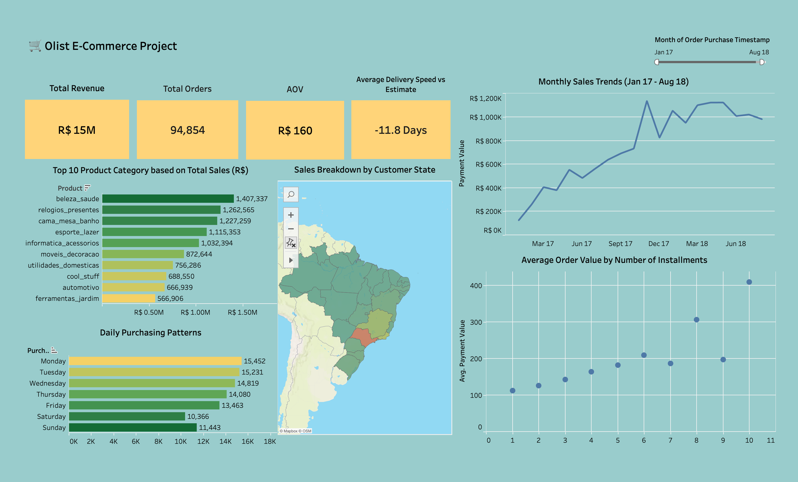
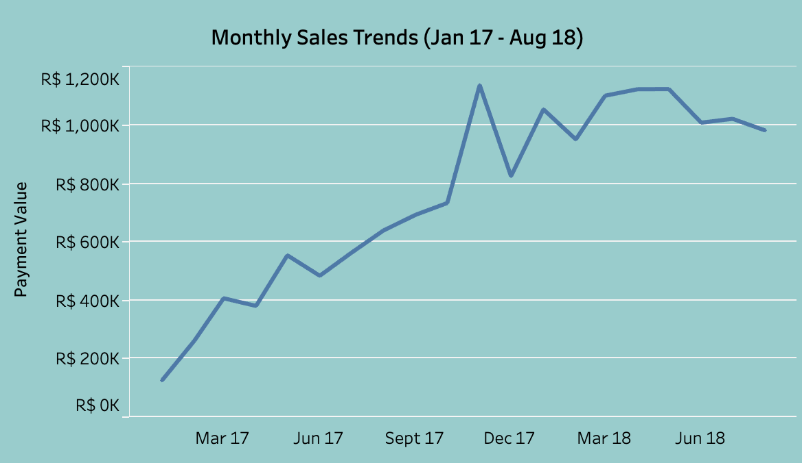
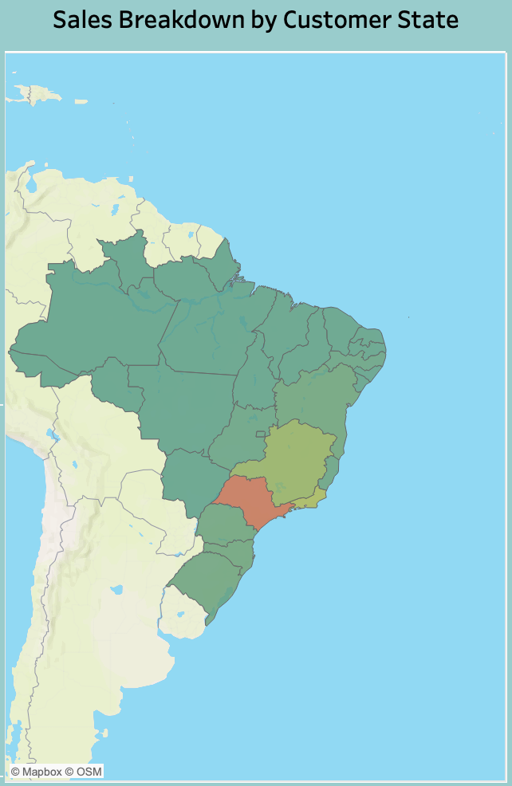
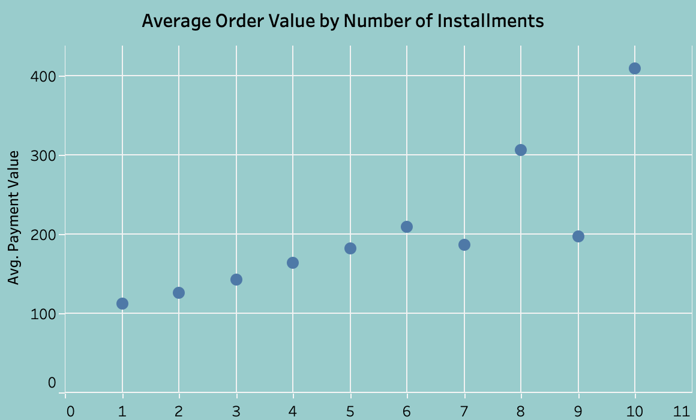

# 🛒 Olist E-Commerce Sales Analysis

> What drives sales at a Brazilian e-commerce marketplace, and where should the business act next?

**Tools:** Excel · Tableau Public | **Period:** Jan 2017 – Aug 2018 | **Dashboard:** [View on Tableau Public](https://public.tableau.com/app/profile/steven.peterson7722/viz/OlistE-CommerceProject_17902199003080/MainDashboard)



---

## 👋 About Me

Hey there 👋 ! I'm Steven and this repository houses my profile description.

**Target role:** Data Analyst / BI Analyst
**Skills & tools:** Excel, Tableau, SQL, Data Visualization
**Contact:** [LinkedIn] · [Email]

---

## 1. Context & Problem

Olist is a marketplace connecting small sellers with customers across Brazil. Management needs to understand **when, where, and how customers buy** so marketing budget, stock, and expansion plans can be prioritised.

**Questions answered**
1. How big is the business and is delivery performance healthy?
2. When do sales peak?
3. Where do sales come from?
4. How do customers pay, and what does that say about order value?

---

## 2. Data

Source: [Olist Brazilian E-Commerce Public Dataset (Kaggle)](https://www.kaggle.com/datasets/olistbr/brazilian-ecommerce) — [ISI: jelaskan singkat bagaimana kamu menyiapkan file Excel ini dari data Kaggle].

Original file used: [`data/Olist_Dataset.xlsx`](data/Olist_Dataset.xlsx)

| Sheet | Rows | Contents |
|---|---|---|
| Orders | 97,688 | One row per order: customer, seller, product category, status, purchase / approval / delivery dates |
| Order_Payments | 103,056 | Payment type, installments, payment value, price, freight |
| Customers | 99,441 | City, state, coordinates |
| Sellers | 3,088 | City, state, coordinates |

**Data checks and preparation**
- `order_id` is unique in Orders; sheets are linked in Tableau by `order_id`, `customer_id`, and `seller_id`.
- Missing dates (e.g. 2,841 orders without a customer delivery date) mostly belong to orders not yet delivered, so they are labelled "Not Delivered" instead of being dropped.
- Known gaps: 750 orders have no payment record, and 218 orders point to a seller missing from the Sellers sheet.
- Product categories are in Portuguese (e.g. `beleza_saude` = Health & Beauty) and were renamed for readability.
- Analysis window is Jan 2017 – Aug 2018. Only 19 orders fall after Aug 2018, so they are excluded.

**Key metrics (calculated fields in Tableau)**
- **Revenue** = sum of `payment_value` (includes freight)
- **AOV** = revenue ÷ distinct orders
- **Delivery Delay (days)** = actual delivery date − estimated delivery date (negative = early)

---

## 3. Headline Numbers

| Revenue | Orders | AOV | Avg. delivery vs estimate |
|---|---|---|---|
| R$15.6M | 96.9K | R$160.7 | 11.8 days earlier |

Delivery is reliable: only 6.8% of delivered orders arrived after the estimated date.

---

## 4. Key Insights & Recommendations

### 🔥 1. Black Friday is the biggest sales spike
Nov 2017 revenue hit **R$1.16M, 55% above Oct 2017**, and 24 Nov alone brought 1,157 orders. December fell back to R$0.85M.
**Recommendation:** Plan stock and marketing budget around November well in advance, and test early-bird campaigns to spread the peak.



### 📍 2. Sales are concentrated in São Paulo
São Paulo contributes **37.4% of revenue**; SP, RJ and MG together make up **62.5%**.
**Recommendation:** Protect the core market, and pilot targeted promotions in lower-volume states to reduce dependence on one region.



### 💳 3. More installments, higher order value
Average payment value rises from **R$112 (1 installment) to R$413 (10 installments)**. Customers appear to use installments for high-ticket purchases (correlation, not proven cause).
**Recommendation:** Promote installment options on high-value products and bundles.



### Supporting observations
- **Health & Beauty** is the top category by revenue (about R$1.44M).
- Orders peak on **Monday (~15.9K)** and are lowest on **Saturday (~10.7K, 33% lower)**, so weekend-only promotions could lift quiet days.

---

## 5. Limitations
- Revenue includes all order statuses; canceled and unavailable orders are about 1.2% of orders.
- Analysis is descriptive; it shows patterns, not causes.

---

## 6. Repository Structure
```
├── README.md
├── data/
│   └── Olist_Dataset.xlsx      # original data used
├── dashboard/
│   └── Olist_E-Commerce_Project.twbx
└── images/                     # dashboard screenshots
```
